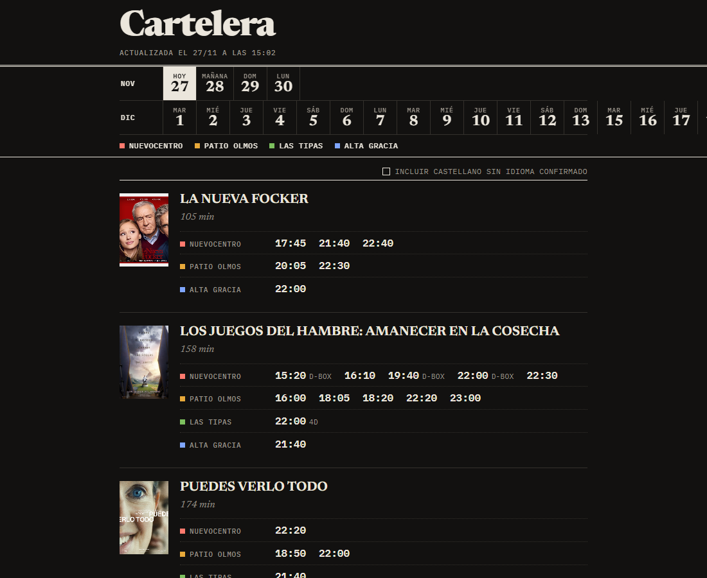
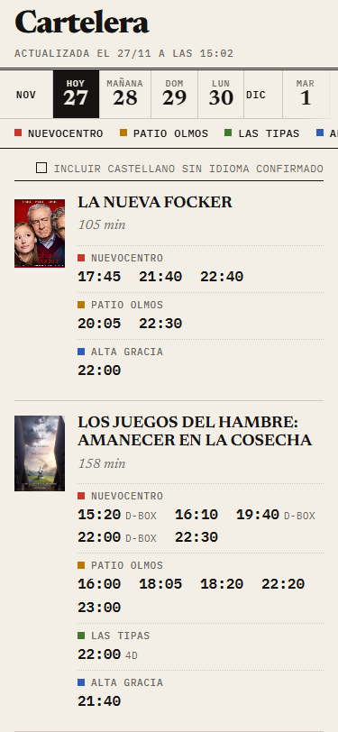
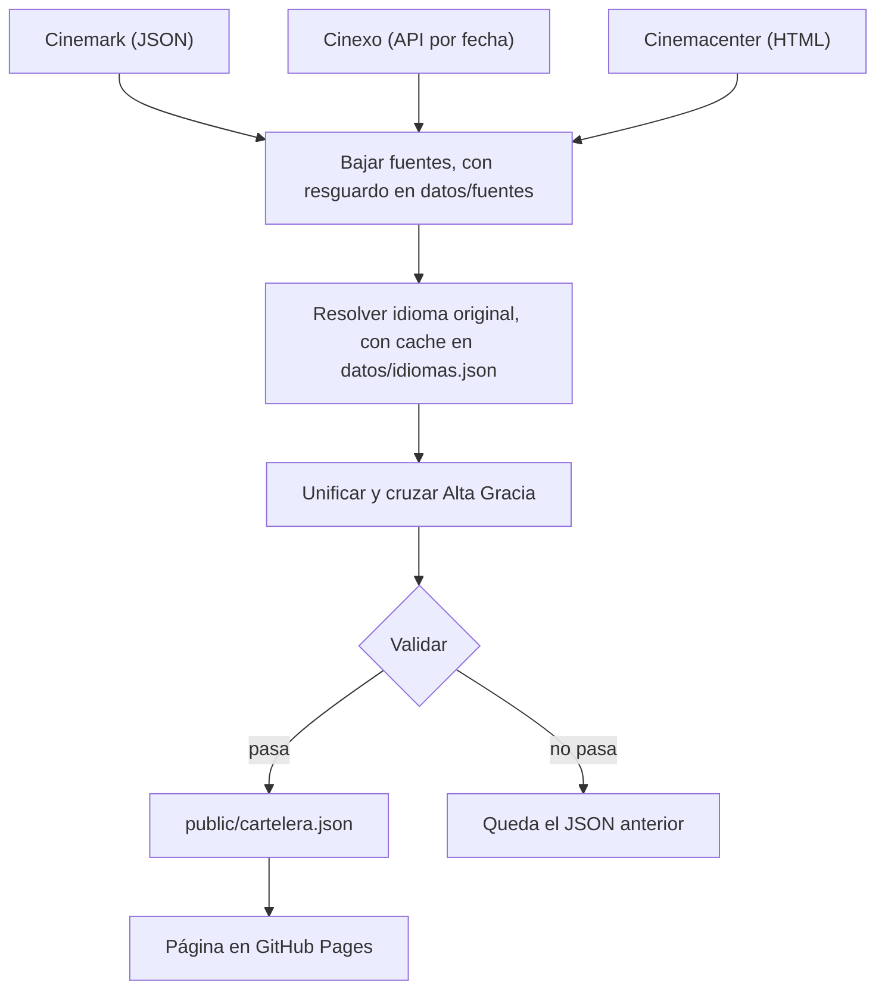

# Cartelera de Córdoba en versión original

Los horarios de cine subtitulado de cuatro salas de Córdoba en una sola página, actualizados cinco veces por día.

**→ [dimapoint.github.io/cartelera-cordoba](https://dimapoint.github.io/cartelera-cordoba/)**

<p>
  
  
</p>

## Qué muestra

Los sitios de los cines mezclan funciones dobladas y subtituladas, y cada uno las publica a su manera. Esta página junta las cuatro carteleras y se queda con lo que se puede ver en idioma original:

- todas las funciones subtituladas;
- las funciones en castellano solo cuando la película es hispanohablante, como una argentina o una española.

| Cine | De dónde salen los horarios |
|---|---|
| Cinemark Nuevocentro | API de cinemark.com.ar |
| Cinemark Patio Olmos | API de cinemark.com.ar |
| Las Tipas | API de Cinexo |
| Cinemacenter Alta Gracia | API de Cinexo (cinealtagracia.com.ar), contrastada con el sitio de Cinemacenter |

### Cómo leer un horario

Como en la cartelera de un diario, se anota solo lo que se sale de lo normal. Un horario sin marcas es una función subtitulada en 2D, y cada horario lleva a la página de compra.

| Marca | Significado |
|---|---|
| `D-BOX`, `4D`, `3D`… | Formato distinto de 2D |
| `cast.` | Hablada en castellano (película hispanohablante) |
| `cast.?` | En castellano de una película cuyo idioma original no se pudo confirmar. Estas funciones quedan ocultas hasta que se tilda «Incluir castellano sin idioma confirmado» |
| `†` en rojo | Los dos sitios de Alta Gracia no coinciden en si la función es subtitulada o doblada |
| `?` en gris | Figura en cinealtagracia.com.ar pero sin venta; ese día el cine suele estar cerrado |
| `(solo cinealtagracia)`, `(solo Cinemacenter)` | La función figura en uno solo de los dos sitios de Alta Gracia, en la semana que publican ambos |
| ~~tachado~~ | La función ya empezó |

La página se puede instalar en el celular y abre sin conexión con los últimos horarios que vio.

## Cómo funciona

Hay dos piezas. Un scraper en Bun baja los horarios, decide qué funciones sirven y escribe `public/cartelera.json`. Una página en React y Vite lee ese archivo y lo dibuja; no tiene backend.



**El idioma original** de cada película se decide una sola vez y queda guardado en `datos/idiomas.json`. El orden es:

1. un override manual en `datos/overrides.json`;
2. la cache;
3. el id de IMDb y, con él, el idioma original en Wikidata (propiedad P364; nunca el país de producción);
4. el anexo de películas argentinas de la Wikipedia en español, para estrenos nacionales chicos que no tienen ítem en Wikidata.

Lo que no se resuelve queda como desconocido y se vuelve a intentar en la próxima corrida.

**Si un cine no responde**, el scraper usa el último resguardo de esa fuente y la página avisa de cuándo son esos datos. Cinemacenter es opcional: Cinexo ya cubre Alta Gracia, y desde los servidores de GitHub se cuelga seguido, así que su caída solo deja una advertencia en el log.

**Antes de escribir**, `scraper/validar.ts` comprueba las invariantes del JSON (ids, estados, que el día de cine cuadre con la hora de inicio, que un conflicto tenga dos versiones distintas). Si algo falla, el archivo no se toca y la página sigue con la última cartelera sana.

**Los datos se commitean**, así que el historial de git muestra cuándo un cine cambió una función.

## Desarrollo

Hace falta [Bun](https://bun.sh) 1.4.3. Edge o Chrome solo hacen falta para las pruebas con navegador y para generar los íconos.

```bash
bun install
bun run dev                  # http://localhost:5173/ con el public/cartelera.json del repo
bun run actualizar           # baja los horarios reales; tarda 2 o 3 minutos
bun test                     # sin red, con respuestas reales guardadas en scraper/fixtures/
bunx tsc --noEmit -p .       # chequeo de tipos (no hay linter)
bun run build                # sitio estático en dist/
```

`bun run actualizar` sale con código 1 si se cayó Cinemark o Cinexo, o si el JSON nuevo no pasa la validación.

Para ver la página como la ve un usuario, con el servidor de desarrollo levantado:

```bash
bun .claude/skills/run-cartelera/driver.ts
```

Usa el Edge o el Chrome instalado para recorrer los días y el filtro de cines, y sale con error si encuentra fallas de consola o scroll horizontal, tanto en escritorio como en celular. Las capturas quedan en la carpeta temporal del sistema. Los detalles, junto con las trampas conocidas de cada fuente, están en [`.claude/skills/run-cartelera/SKILL.md`](.claude/skills/run-cartelera/SKILL.md).

## Corregir una película

Si una película quedó con el idioma mal, o aparece algo que no interesa (un concierto, por ejemplo), se arregla en `datos/overrides.json`, sin tocar código:

```json
{
  "Cordobeces": { "ocultar": true, "motivo": "descartada a mano" },
  "Título de la película": { "idiomaOriginal": "es", "motivo": "coproducción hablada en castellano" }
}
```

La clave es el título como lo publica el cine, sin el sufijo de formato (`- 2D SUB`); no importan mayúsculas ni tildes. `idiomaOriginal` acepta `"es"` u `"otro"`, y el override gana sobre todo lo demás.

Si el problema es que la cache guardó una película equivocada, alcanza con borrar su entrada de `datos/idiomas.json` y correr `bun run actualizar`: se vuelve a buscar.

## Publicación

[`.github/workflows/actualizar.yml`](.github/workflows/actualizar.yml) corre con cada push a `main` y a las 10, 13, 16, 19 y 22 h de Córdoba. Pasa los tests, corre el scraper, commitea los datos como `github-actions[bot]`, compila y publica en GitHub Pages.

Si se cae Cinemark o Cinexo, publica igual con los datos anteriores y el último paso falla a propósito para que llegue el mail de GitHub.

Como el bot commitea a `main` varias veces por día, conviene hacer `git pull --rebase` antes de pushear.

## Estructura

```
src/                  la página (React)
  cartelera.ts          reglas puras: qué se ve y cómo se agrupa
  componentes/          piezas de la interfaz
scraper/
  fuentes/              un módulo por cine
  idioma/               IMDb, Wikidata y el anexo argentino
  unificacion/          identifica películas y cruza Alta Gracia
  validar.ts            la compuerta antes de escribir
  fixtures/             respuestas reales para los tests
datos/                resguardos por fuente, cache de idiomas y overrides
public/               cartelera.json, manifiesto, service worker e íconos
```

## Contribuir

Las convenciones de código, tests y commits (Conventional Commits en español, del tipo `fix(cinexo): ...`) están en [`AGENTS.md`](AGENTS.md). [`CLAUDE.md`](CLAUDE.md) resume la arquitectura y las convenciones difíciles de descubrir.

## Aviso

Es un proyecto personal, sin relación con Cinemark, Cinexo ni Cinemacenter. Los horarios y los pósters salen de los sitios de cada cine y pueden cambiar: confirmá en el link de compra antes de ir.
